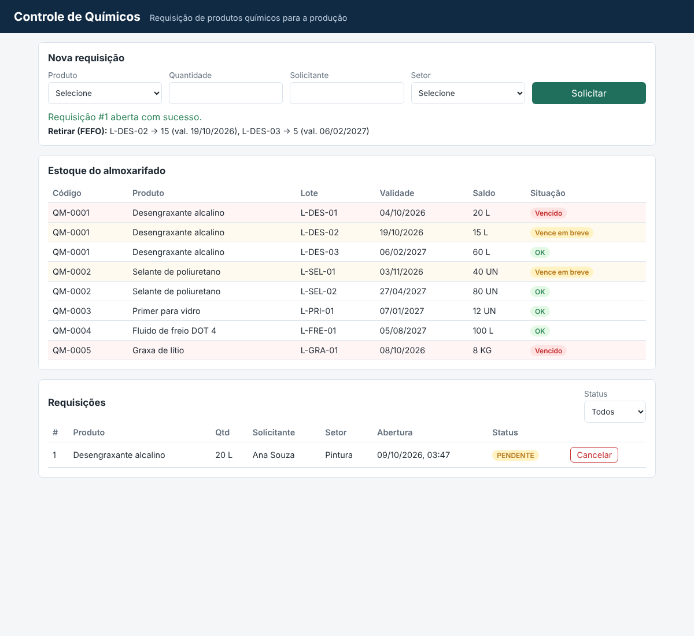

# Controle de Químicos


Sistema de requisição de produtos químicos para a linha de produção, com **regra FEFO**, **controle de validade** e **fechamento automático** a partir das movimentações do ERP. O foco do repositório é a **estratégia de testes**: unitários, de API e E2E, rodando no GitHub Actions.

> **Origem:** projeto inspirado em um sistema real que mantenho no trabalho, originalmente em ColdFusion + Oracle integrado ao ERP. Aqui ele foi reescrito do zero em Node.js, com dados fictícios e sem nenhum código ou informação da empresa. Os dois defeitos documentados em `docs/bugs` foram encontrados no sistema original e reproduzidos aqui como testes de regressão.



## Regras de negócio

| Regra | Descrição |
|---|---|
| **FEFO** | Ao abrir uma requisição, o sistema sugere de quais lotes retirar, começando pelo que vence primeiro |
| **Validade** | Lote vencido não conta como saldo e nunca é sugerido. Lotes que vencem em até 30 dias aparecem destacados |
| **Saldo** | Requisição maior que o saldo válido é bloqueada, informando quanto falta |
| **Cancelamento** | Apenas requisições pendentes, com motivo obrigatório |
| **Fechamento automático** | A requisição vira ATENDIDA quando o ERP registra entregas do produto para a produção (`PRD`), feitas após a abertura, somando a quantidade pedida. Cada entrega é usada uma única vez |

## Testes

| Nível | Ferramenta | Qtd. | O que cobre |
|---|---|---|---|
| Unitário | Jest | 28 | Regras puras: FEFO, validade (valor limite), fechamento automático e validações |
| API | Jest + Supertest | 19 | Status HTTP, persistência, entradas maliciosas e fluxo com o ERP simulado |
| E2E | Playwright | 7 | Jornadas na interface: abrir, validar, cancelar, fechar automaticamente e filtrar |

Cobertura de código (unitários + API): **~95% das linhas**.

**Destaques da abordagem:**

- **Relógio injetável:** a data atual é passada para a aplicação, então os testes de validade e de fechamento não quebram com o passar do tempo.
- **Testes de regressão rastreáveis:** cada bug corrigido tem testes marcados com o ID (`[BUG-001]`, `[BUG-002]`).
- **Teste de mutação manual:** removi de propósito os filtros corrigidos nos bugs e confirmei que os testes de regressão falham.
- **Segurança básica:** consultas parametrizadas e escape de HTML na tela, verificados com uma entrada contendo SQL e `<script>`.

## Documentação de QA

- [Plano de testes](docs/plano-de-testes.md): escopo, estratégia, técnicas, critérios e riscos
- [Casos de teste](docs/casos-de-teste.md): 27 casos com prioridade e onde cada um está automatizado
- [BUG-001: fechamento automático não dispara](docs/bugs/BUG-001-fechamento-automatico-nao-dispara.md)
- [BUG-002: entrega antiga fecha requisição nova](docs/bugs/BUG-002-entrega-antiga-fecha-requisicao-nova.md)

## Como rodar

Requer **Node.js 22.13+** (usa o SQLite nativo do Node, sem dependência de banco externo).

```bash
npm install
npm start                    # http://localhost:3000

npm test                     # unitários + API
npm run test:coverage        # com relatório de cobertura
npx playwright install chromium
npm run test:e2e             # E2E (sobe o servidor sozinho)
```

## API

| Método | Rota | Descrição |
|---|---|---|
| GET | `/api/produtos` | Produtos, lotes, situação de validade e saldo disponível |
| GET | `/api/requisicoes?status=` | Lista requisições (executa o fechamento automático antes) |
| GET | `/api/requisicoes/:id` | Detalhe de uma requisição |
| POST | `/api/requisicoes` | Abre requisição e retorna a sugestão FEFO |
| POST | `/api/requisicoes/:id/cancelar` | Cancela com `{ "motivo": "..." }` |
| POST | `/api/erp/movimentacoes` | Simula uma transferência registrada no ERP |
| POST | `/api/auto-fechamento` | Executa o fechamento automático manualmente |

## Estrutura

```
src/
  regras.js     regras de negócio puras (alvo principal dos testes unitários)
  app.js        rotas da API (Express)
  db.js         schema SQLite e massa de dados fictícia
public/         interface (HTML, CSS e JavaScript puro)
tests/
  unit/         Jest
  api/          Jest + Supertest
  e2e/          Playwright
docs/           plano de testes, casos de teste e relatórios de bug
.github/        pipeline de CI
```

## Stack

Node.js 22 · Express 5 · SQLite (`node:sqlite`) · Jest · Supertest · Playwright · GitHub Actions

---

Feito por [Marcelo Rodrigues](https://www.linkedin.com/in/marcelo-rodrigues-macedo-filho-b657432b1)
